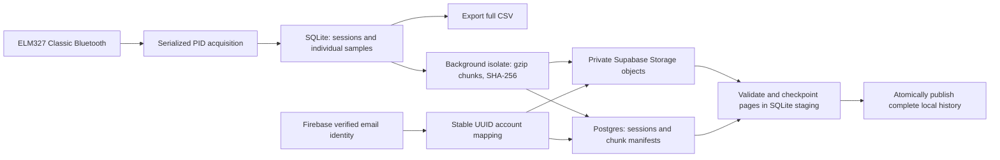

# Verified accounts and long recording storage

This branch uses **Firebase Authentication Spark + Supabase Free + phone SQLite**.
No purchased domain, SMTP account, billing account, Firebase Storage, Firestore,
Cloud Function, or paid ML server is required. Firebase's default hosted email
action page handles verification and password reset.

## Run this branch on an existing phone

1. Keep the installed app: do **not** uninstall it or clear its storage.
2. Run `flutter pub get`, select the Android phone, then `flutter run`.
   The application ID remains `com.example.autopulse_ai`; use the same signing
   certificate as the installed app. Version is `1.1.0+2`.
3. Existing Supabase users must create a Firebase account **once with their
   existing email**, open the verification email, and return to the app.
4. On the verification screen, enter the **previous AutoPulseAI password** in
   the existing-user field and select **I verified my email — continue**.
   This proves access to both accounts and keeps the original internal UUID.
   The Firebase password may differ from the previous password.
5. Later sign-ins use the Firebase password. Cars and completed cloud runs
   restore into the same account. A cached, verified account can open its local
   recordings without internet. Continue without an account also remains available.

If verification mail is delayed, check spam and use Resend after waiting. Sending
limits still apply to the free plan. Reset password sends a browser link, not an
in-app recovery code. No passwords or Firebase tokens are stored in app-owned
preferences. Firebase's SDK manages authentication persistence.

Do not downgrade a phone back to code that only supports SQLite schema 2 after
this branch upgrades it to schema 3. Keep exports/backups before switching app
versions. Old data is retained; an older binary may be unable to open the newer
schema. Changing application ID or signing certificate prevents an in-place
update; never uninstall as a workaround before exporting unsynced recordings.

## Data flow

Each raw sample retains PID, nullable value, original unit, quality, UTC request
and receive timestamps, latency, source ECU, and stable acquisition order. The
cloud format is `gzip-json-v1`; compression does not resample or discard data.
Existing `rows-v1` runs remain in `obd_recording_samples` and use the legacy reader.
New raw recordings do **not** populate `telemetry_readings` or duplicate every
sample into the old SQL samples table.

| Location | Purpose |
|---|---|
| Firebase Authentication | Email/password credentials, verification and reset |
| Private `accounts` / `firebase_identities` | Stable UUID and Firebase UID mapping |
| Private `account_links` | Single-use, 15-minute proof of the old account |
| `profiles` | Owner display name |
| `vehicles` | Owner cars |
| `obd_recording_sessions` | Recording identity, timing, expected count, format, completion |
| `obd_recording_chunks` | Immutable object paths, sequence, row count, bytes, SHA-256 |
| Private Storage bucket `obd-recordings` | Lossless compressed measurement chunks |
| Legacy `obd_recording_samples` | Existing row-based runs; still readable |
| SQLite `restore_jobs` / `restore_samples` | Hidden, durable partial download staging |

## Recording, retry and recovery

- Acquisition commits to SQLite before any cloud work. Internet is unnecessary
  for collecting, viewing or exporting recordings.
- The foreground coordinator retries every 30 seconds and on resume; transient
  failures additionally use bounded exponential retry. Network work never enters
  the ELM command queue.
- Already-owned active runs back up complete 1,000-reading chunks. A growing tail
  stays local until it becomes a complete chunk or recording stops. Offline runs
  require the existing explicit upload/ownership confirmation after stopping.
- Chunk identity is deterministic. The server reserves a path and byte budget;
  upload uses insert-only objects. If an acknowledgment is lost, a retry downloads
  an existing object and checks its hash before acknowledging it locally.
- A local cursor advances only after acknowledgment. Completed runs are marked
  synced only after the completion RPC checks expected totals and object sizes.
- At process startup, interrupted SQLite sessions close at their last saved
  timestamp (or start time if empty), making their durable prefix uploadable.
- Restore supports both formats. It validates each bounded page, persists a
  cursor in staging, and resumes interrupted downloads. Partial trips are hidden.
  Only a matching total is promoted to the normal history in one transaction.
- Signing out and switching accounts stop acquisition; account checks after
  awaits prevent network results being accepted under another owner.

**Recording remains foreground-only.** Keep the app visible and screen awake
during the car session. A background Android service is outside this change.
Uploading chunks is not the same as confirming that the unfinished recording is
complete; another device restores only completed uploads.

## Capacity and integrity

The project remains on finite free tiers. The application reserves an **850 MB
project recording budget**, leaving headroom inside the 1 GB Supabase Storage
allowance. Other stored objects are considered when reserving chunks. This is
an application safeguard, not a replacement for monitoring Supabase's database,
object storage and egress quotas. Existing SQL data is retained and still counts
toward the database quota. No automatic cloud or phone deletion is introduced.

Settings shows compressed account usage and the shared recording budget, with
a warning at 80%. When capacity or connectivity prevents backup, phone recording
and CSV export continue; failed data stays available for retry. Archive/export
data deliberately before an administrator removes cloud copies. Free allowances
and service availability can change; see the providers' current pricing pages.

Chunks have at most 1,000 readings, 1 MiB compressed and 4 MiB expanded. Hash,
size, count, sequence, ownership, supported PID and measurement-quality checks
run before importing data. Compression/decompression runs off the Android UI
isolate. The server checks storage presence/size and manifests; it does **not**
independently decompress and attest sensor truth. Any ML ingestion must also
verify archives and must not treat user uploads as trusted ground truth.

The automated scale fixture round-trips **105,120 synthetic readings**, using
at most 1,000 readings per Dart page. Its measured compressed size was
**1,711,899 bytes**. This is a synthetic storage check, not a measured Yaris run,
hardware throughput result or a guarantee of real-world compression.

## Authentication and access rules

Supabase verifies tokens against the configured Firebase project. SQL additionally
checks the exact issuer/audience, verified-email claim and identity mapping.
Firebase UIDs are text; application ownership remains UUID-based. No Firebase UID
is cast through `auth.uid()`.

Firebase Spark tokens have no custom Postgres `role` claim. The narrowly scoped
tables/RPCs therefore grant the database `anon` role access **only through policies
that require a valid, verified, project-bound token and its mapped owner**. An
unauthenticated public-key request sees no rows and cannot create an account or
reserve/upload an object. This avoids a paid Firebase function for custom claims.

Private identity tables have schema/table privileges revoked and RLS enabled.
Clients cannot insert identities, choose account IDs or claim old accounts by
email alone. Linking consumes proof from a separate successful old-account login.
Cars/sessions retain composite ownership foreign keys. Storage objects are private
and insert-only; clients cannot change or delete them. Only the completion RPC
can set `uploaded_at`, and completed recording metadata is immutable.

Existing, **unlinked accounts present at the cutover** remain compatible during
transition. New Supabase Auth identities do not receive legacy data access, even
if its signup endpoint is later reopened; they must use verified Firebase linking.
After linking, their legacy tokens no longer access app data; they must use the
verified Firebase account. Old Supabase Auth records are retained for migration.
Do not delete old auth users, alter owner IDs or disable RLS as a migration shortcut.

## Configuration and deployment record

Public client settings are committed in `assets/supabase.public.json` and
`lib/core/config/firebase_config.dart`. The Firebase project is
`autopulseai-1fca7`; the existing Supabase project is `ffedjcrehudjwvdogqiw`.
Explicit Supabase `.env` overrides must point to a project configured with the
matching auth integration and migrations. Never bundle administrator/service
account keys, Supabase service-role keys, database passwords or SMTP passwords.

On **2026-11-07**, Firebase was created on Spark, Android/web app identities were
registered, email/password was enabled, and Supabase's Firebase connection was
enabled. The existing project received the following after its three October
migrations:

1. `20261107000000_verified_accounts.sql`
2. `20261107010000_recording_chunks.sql`
3. `20261107020000_recording_completion_guard.sql`
4. `20261107030000_legacy_auth_cutover.sql`

Do not replay these non-idempotent migrations. SQL-editor deployment does not
automatically reconcile Supabase CLI migration history. A post-deployment check
found **8 legacy sessions, 9,638 legacy samples, 3 accounts, three protected private
identity tables, and a private recording bucket**. No legacy samples were moved
or deleted. There were 14 MB in the database at that check.

## Validation and phone acceptance

CI retains formatting, analysis, unit/widget tests, PostgreSQL RLS checks and the
Android release build. Its new branch trigger includes this feature branch.
The CI-only auth/storage fixture is never a production migration.

Automated checks cover unverified/wrong-project/anonymous denial, legacy ownership
linking, duplicate/conflicting reservations, missing objects, completion guards,
corrupt hashes, expansion limits, interrupted restore, active-tail handling,
restart recovery and the large synthetic archive. Firebase unit tests mock email
sending; they do not demonstrate inbox delivery on a physical phone.

Before merge, test on Android:

1. In-place update; check original local runs before doing anything destructive.
2. Create/verify/link the existing account and confirm old cars and cloud runs.
3. New account signup, verification resend, sign-out/sign-in and reset email.
4. Record offline; regain connectivity; check a completed run restores on a second
   phone with identical counts/quality, graph values and CSV content.
5. During an owned active run, verify full chunks appear; the tail finishes on Stop.
6. Interrupt upload/download and restart; ensure no duplicate or partial visible run.
7. Switch accounts; verify each account sees only its own cloud cars and runs.
8. Collect an actual long session before claiming 5–10-hour hardware validation.

No merge to `main` is part of this change. Phone acceptance remains required.
