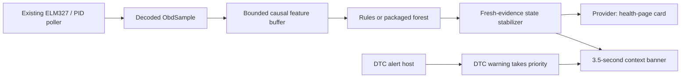

# Driving context: implementation and validation

This document records the initial rules-only implementation. A subsequent
user-authorized experiment labelled the existing Yaris data, trained models and
packaged an experimental hybrid. See [the current experiment](yaris-weak-label-experiment.md)
for the updated model, labels, APK and validation state.

17 November 2026. Development branch: `feature/driving-context-runtime`, based on
`main` at `591a07c`. Publication uses this separate feature branch; merging into
`main` is a separate review decision.

## Delivered behavior

Vehicle Health now shows a live Driving Context card below the existing score.
It uses the existing slate/teal theme, Material icons and Inter typography. The
sample-health notice explicitly applies to the mock score/system tiles; live
context does not alter the 87/100 score. A large-text overflow in the existing
score row was fixed while testing this screen.

The existing Bluetooth poller calls `drivingContext.accept(sample)` once for each
decoded attempt, including invalid/no-data attempts. It does not establish another
Bluetooth connection or request extra PIDs. Freshness expiry uses the existing
one-second age timer. Decisions run on the phone without an inference API call.

States include engine off, idling, city/highway cruising, ordinary acceleration,
strong acceleration, deceleration and heavy load, plus waiting/disconnected states.
High demand remains a separate flag during acceleration/deceleration. City/highway
are speed-based estimates; load does not prove a mountain ascent or a fault.
Transition confirmation requires new speed samples, not repeated timer ticks.
The initial classification/recovery is quiet. Significant notices have a 25s
cooldown, slide/fade for 240ms and dismiss after 3.5s. They pass taps through and
are discarded while the existing interactive DTC warning is visible.

## Model status and structure

**Current runtime: `rules-v1`. No real context classifier has been trained or
validated.** `assets/ml/registry.json` deliberately has `driving_context: null`.
The real training command was checked with the empty sidecar template; it exited
with "No reviewed context labels" instead of fabricating a model or accuracy.

`ml/driving_context/` contains causal Python features, replay, annotation format,
training, comparison and bounded JSON export. Training compares a shallow tree,
20/40-tree forests and rules, using separate whole days for training, tuning and
untouched testing. Exported reports preserve data/annotation hashes and session
provenance. The existing server-side MAF model remains separate.

For a reviewed accepted artifact, copy its versioned JSON into
`assets/ml/driving_context/`, select its path in the registry and rebuild. Startup
loads it into the same live controller automatically. The interpreter preserves
scikit-learn float32 split behavior and averaged leaf distributions. Bad/missing
models fall back to labelled provisional rules. Explicit synthetic test artifacts
are rejected by the production asset loader.

The small forest in `test/fixtures/driving_context_parity.json` is trained on
synthetic software-test examples only. It is not a runtime asset or a vehicle
accuracy result. The Python end-to-end training test also uses temporary,
explicitly synthetic recordings/annotations and deletes its temporary artifacts.

Generated files stay under ignored `ml/output/driving_context/`. Raw Yaris CSVs
were not modified. `ml/README.md` is the repository's model-task index;
`D:\FYP\ML_WORKSPACE.md` explains the local workspace layout.

## Recorded replay evidence

Three recordings, 41,866 PID attempts, about 2.7034 hours, from two recording days.
The CSV `label` field is a PID name; none of these files supplies reviewed context
labels. Replay observes each sample only after its received timestamp, resets
between recordings and includes the last partial second.

| Recording suffix | PID attempts | Evaluation ticks | Complete features | Availability |
| --- | ---: | ---: | ---: | ---: |
| 0511a87a | 11,850 | 2,650 | 2,584 | 97.51% |
| 5e55e4a8 | 20,365 | 4,880 | 3,895 | 79.82% |
| ea483f87 | 9,651 | 2,207 | 2,202 | 99.77% |

The actual Dart runtime matched Python features, confirmed primary states and
high-demand flags at all **9,737 replay evaluation ticks**, covering all **41,866
PID attempts**. This establishes software agreement, not whether a context was
correct. Desktop replay including file parsing/assertions took about 1.1 seconds
in the full test run; phone inference timing has not been measured.

The provisional rules generated 153 significant notices in replay: 78 high-demand
and 75 deceleration notices. Without reviewed event labels, none can be counted
as a true or false alert. Notification frequency/dwell/thresholds need review on
car before a release; do not claim the false-notice-per-hour goal is met. No
strong-acceleration context was confirmed in these three recordings with the
current thresholds; this does not prove that the class has been validated.

Local reproducible evidence:

- `ml/output/driving_context/replay/replay-report.json`
- `ml/output/driving_context/replay/*-timeline.csv`: inspect estimates and features.
- `ml/output/driving_context/replay/*-replay.jsonl`: causal Python references for Dart.
- `.task-cache/context-full-tests-final.log` under `D:\FYP`: local test log.
- `build/driving-context-previews/`: 320/390/414px normal and heavy-load/banner images.

## Checks and limits

Python unit tests cover missing/invalid/stale/future readings, independent-label
requirements, chronological splits, synthetic fitting/export, forest parity and
existing MAF/recording-integrity regression cases. Flutter tests cover physical
states, isolated noise/downshifts, sustained demand, no timer-based confirmation,
cooldown/reset/disposal, explicit model handoff, real poller integration, banner
touch-through/dismissal/reduced motion, DTC priority and large text. Phone-width
previews were inspected against existing theme tokens. Final checks: Flutter
analysis clean, Dart formatting clean, 247 Flutter tests passed (one opt-in live
backend test skipped), nine Python tests passed. Local replay was enabled for
that Flutter run; CI skips the local-data replay when no tape path is supplied.
The final Android debug build succeeded. The signed APK is saved locally at
`D:\FYP\artifacts\driving-context\debug.apk`, with SHA-256/build details in
`build-info.json` beside it. It was checked to contain the rules registry and no
synthetic parity fixture. Android 8.0/API 26 or newer is required.

This task does not change database schema, account policies, saved recordings or
server training. Live cloud/backend checks remain opt-in. A physical adapter and
phone test was not performed for this implementation run. No claim of bug-free
hardware operation, measured context accuracy, calibrated confidence, confirmed
inclines, mechanical diagnosis or cross-vehicle accuracy is made.

## Phone acceptance procedure

1. Install the new debug APK and open the existing Live Monitor connection flow.
   Connect to the paired ELM327 with ignition/engine in the appropriate state.
2. Open Vehicle Health. The card should progress from Reading context to a live
   estimate after fresh core readings and the confirmation window are available.
   Idling needs approximately stationary speed and running RPM; stationary revving
   must remain stationary context.
3. Have a passenger observe the card during ordinary lawful steady movement,
   acceleration and deceleration. Review sustained high-demand periods if they
   occur naturally; OBD load alone cannot establish an incline.
4. Check the banner dismisses and screen taps still work. An ECU DTC warning must
   retain priority. Do not create a fault or clear real DTCs just for this check.
5. Disconnect/reconnect, switch vehicles/accounts and background/resume. Old context
   must clear; pauses/missing PIDs should show waiting rather than fabricated values.
6. Record independent timestamps/context notes and review the sidecar annotations.
   Collect further days/events before training, then evaluate held-out accuracy,
   event precision/recall, notice frequency, delay and coverage before packaging ML.
